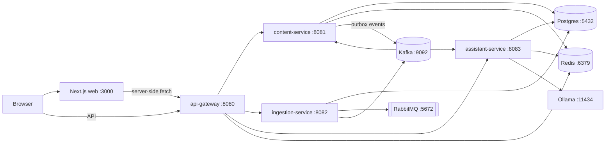

# Pulse — code repository (Blog_007)

A microservices blog platform (Tech · Football · AI) with an AI assistant, built with Spring Boot,
Kafka, RabbitMQ, Redis, PostgreSQL and Next.js.

**Designed and developed by Ankur Kumar.** © 2026 Ravenclaw_007 LLC. All rights reserved.

---

## Contents

1. [What runs where](#1-what-runs-where)
2. [Prerequisites (one-time)](#2-prerequisites-one-time)
3. [First-time setup](#3-first-time-setup)
4. [Start the infrastructure](#4-start-the-infrastructure)
5. [Build the backend](#5-build-the-backend)
6. [Start the services](#6-start-the-services)
7. [Start the website](#7-start-the-website)
8. [Try it out](#8-try-it-out)
9. [Tests and load tests](#9-tests-and-load-tests)
10. [Optional: run on Kubernetes (kind)](#10-optional-run-on-kubernetes-kind)
11. [Stop, restart, reset](#11-stop-restart-reset)
12. [Troubleshooting](#12-troubleshooting)
13. [Project status and layout](#13-project-status-and-layout)

---

## 1. What runs where



| Component | Port(s) | Started by | Needed for |
|---|---|---|---|
| PostgreSQL 18 + pgvector | 5432 | Docker Compose, profile `core` | everything |
| Redis 8 | 6379 | Docker Compose, profile `core` | caching, rate limits, chat memory |
| Kafka 4 (KRaft) + Kafka UI | 9092, UI 8085 | Docker Compose, profile `msg` | events (publish → site refresh), ingestion, embeddings |
| RabbitMQ 4 | 5672, UI 15672 | Docker Compose, profile `msg` | feed-fetch jobs (Phase 7) |
| content-service | 8081 (actuator 9081) | `./mvnw … spring-boot:run` | posts, search, admin, auth |
| api-gateway | 8080 (actuator 9080) | `./mvnw … spring-boot:run` | single entry point, JWT check, rate limiting (Phase 5) |
| ingestion-service | 8082 (actuator 9082) | `./mvnw … spring-boot:run` | external blog feeds (Phase 7) |
| assistant-service | 8083 (actuator 9083) | `./mvnw … spring-boot:run` | "Ask Pulse" chatbot (Phase 8) |
| Ollama (native, not Docker) | 11434 | `brew services start ollama` | local LLM + embeddings (Phase 8) |
| Next.js web | 3000 | `npm run start` | the website and admin UI |

**Minimum to see the website:** Postgres + Redis + content-service + web. Everything else is additive.

---

## 2. Prerequisites (one-time)

Written for macOS on Apple Silicon. **16 GB RAM** works if you only start what you need; give
Docker Desktop **8 GB** (Settings → Resources → Memory).

| Tool | Version | Install | Check |
|---|---|---|---|
| Homebrew | any | https://brew.sh | `brew --version` |
| JDK | **25** | Eclipse Temurin 25 from https://adoptium.net (or SDKMAN: `sdk list java`, then `sdk install java <25.x-tem>`) | `java -version` |
| Docker Desktop (or OrbStack) | recent | https://www.docker.com/products/docker-desktop | `docker version` shows Client **and** Server |
| Node.js | 20.9+ (LTS recommended) | `brew install node` or a version manager (fnm/nvm) | `node -v`, `npm -v` |
| Git | any | `brew install git` | `git --version` |
| k6 *(optional)* | latest | `brew install k6` | `k6 version` |
| Ollama *(Phase 8)* | latest | `brew install ollama` | `ollama --version` |
| kind, Helm, kubectl *(Phase 10)* | latest | `brew install kind helm kubectl` | `kind version`, `helm version` |

You do **not** need to install Maven: the repository ships the Maven Wrapper (`./mvnw`), which downloads
the pinned Maven version on first use.

---

## 3. First-time setup

All commands run from the `Blog_007/` folder unless stated otherwise.

```bash
git clone https://github.com/Ankur42177/The-Dark-Algorithm.git
cd The-Dark-Algorithm/Blog_007
```

### 3.1 Create your `.env` (secrets live only here — it is git-ignored)

```bash
cp .env.example .env
```

Open `.env` and replace every `change-me-…` value with your own random string (for example the output of
`openssl rand -hex 16`, one per value). These become the database, RabbitMQ and webhook passwords.

### 3.2 Generate the JWT signing keys

```bash
./scripts/gen-jwt-keys.sh
```

Writes `PULSE_JWT_PRIVATE_KEY` and `PULSE_JWT_PUBLIC_KEY` (RSA-2048, single-line Base64) into `.env`.
Re-running it rotates the keys and logs everyone out.

### 3.3 Set the admin password

```bash
./scripts/hash-password.sh       # asks for a password (min 12 characters), stores only its BCrypt hash
```

The admin user is `ankur` (display name "Ankur Kumar"; change via `ADMIN_USERNAME` / `ADMIN_DISPLAY_NAME`).

### 3.4 Website environment

```bash
cp web/.env.example web/.env.local
```

Set `REVALIDATE_SECRET` in `web/.env.local` to **the same value** as `REVALIDATE_SECRET` in `.env`:
content-service uses it to tell the website to refresh pages after a post is published.
`PULSE_API_URL` / `NEXT_PUBLIC_API_URL` point at the gateway (`http://localhost:8080`); if you are not
running the gateway, use content-service directly: `http://localhost:8081`.

---

## 4. Start the infrastructure

Make sure Docker Desktop is running, then:

```bash
# Postgres + Redis (always needed)
docker compose -f infra/docker-compose.yml --env-file .env --profile core up -d

# Kafka + Kafka UI + RabbitMQ (events, ingestion and the chatbot's embeddings)
docker compose -f infra/docker-compose.yml --env-file .env --profile msg up -d

# Check: every container should become "healthy"
docker compose -f infra/docker-compose.yml --env-file .env --profile core --profile msg ps
```

On the first start, Postgres runs `infra/postgres/init/01-create-databases.sh`, which creates
`content_db`, `ingestion_db` and `assistant_db`, each with its own user (database per service).

| UI | URL | Login |
|---|---|---|
| Kafka UI | http://localhost:8085 | none |
| RabbitMQ management | http://localhost:15672 | `RABBITMQ_USER` / `RABBITMQ_PASSWORD` from `.env` |
| Postgres shell | `docker exec -it pulse-postgres psql -U content -d content_db` | — |
| Redis shell | `docker exec -it pulse-redis redis-cli` | — |

Tip — add an alias to `~/.zshrc`:
`alias dc='docker compose -f infra/docker-compose.yml --env-file .env'`, then `dc --profile core up -d`.

---

## 5. Build the backend

```bash
./mvnw -DskipTests package          # compile + package every module (first run downloads dependencies)
```

Each service also builds on its own: `./mvnw -pl services/content-service -am -DskipTests package`
(`-pl` = this module, `-am` = also the modules it depends on, such as `libs/events`).

---

## 6. Start the services

Use one terminal per service. Each service reads `.env` automatically (`spring.config.import`), runs its
own Flyway database migrations at startup, and reports health at
`http://localhost:<actuator-port>/actuator/health`.

### 6.1 content-service (required)

```bash
./mvnw -pl services/content-service -am spring-boot:run -Dspring-boot.run.profiles=dev
```

The `dev` profile loads sample posts. Ready when `curl -s localhost:9081/actuator/health` returns
`{"status":"UP",…}`. Swagger UI: http://localhost:8081/swagger-ui.html

### 6.2 api-gateway (Phase 5)

```bash
./mvnw -pl services/api-gateway spring-boot:run
```

Routes `/api/v1/**` to the services, validates admin JWTs, rate-limits per IP (Redis) and adds an
`X-Request-Id` to every request. Details: `services/api-gateway/README.md`.

### 6.3 ingestion-service (Phase 7)

Fetches the curated blog feeds through RabbitMQ workers and publishes new articles to Kafka. Needs the
`msg` profile. Run instructions and its two roles (scheduler / worker) are in
`services/ingestion-service/README.md`.

### 6.4 assistant-service — "Ask Pulse" chatbot (Phase 8)

```bash
brew services start ollama                     # or: ollama serve   (in its own terminal)
ollama pull qwen3:4b                           # chat model with tool calling (~2.5 GB)
ollama pull nomic-embed-text                   # embedding model (~270 MB)
./mvnw -pl services/assistant-service -am spring-boot:run -Dspring-boot.run.profiles=api,embedder
```

`api` serves the chat endpoint; `embedder` consumes Kafka events and stores embeddings in pgvector.
Change models with `PULSE_CHAT_MODEL` / `PULSE_EMBEDDING_MODEL`. If Ollama is stopped, the chatbot
falls back to "search mode" (plain links) instead of failing. Details: `services/assistant-service/README.md`.

---

## 7. Start the website

```bash
cd web
npm install
npm run build        # pre-renders the pages: the backend must be running
npm run start        # production server on http://localhost:3000
# or, while developing:  npm run dev   (hot reload, slower pages)
```

---

## 8. Try it out

| What | Where |
|---|---|
| Website | http://localhost:3000 (`/tech`, `/football`, `/ai`, article pages) |
| Admin login and editor | http://localhost:3000/admin/login — user `ankur`, the password from step 3.3 |
| Public API (through the gateway) | `curl -s 'localhost:8080/api/v1/posts?limit=3' \| jq` |
| Search | `curl -s 'localhost:8081/api/v1/search?q=kafka' \| jq` |
| Trending | `curl -s localhost:8081/api/v1/trending \| jq` |
| API docs | http://localhost:8081/swagger-ui.html |
| Kafka events | http://localhost:8085 → topic `content.post.events` |

**End-to-end check:** log in to the admin UI, create a post, click **Publish**, then open its section
page. The post appears within about a second (outbox → Kafka → cache eviction → page revalidation),
without restarting anything.

---

## 9. Tests and load tests

```bash
./mvnw verify                                         # all modules: unit + integration tests (Docker must run)
./mvnw -pl services/content-service -am verify        # one service
cd web && npx tsc --noEmit                            # website type check
```

Integration tests start throw-away Postgres/Redis/Kafka containers with Testcontainers, so they never
touch your local data.

The chatbot has a golden-set evaluation (20 questions → expected tool and citation) that runs against the
real local model:

```bash
./mvnw -pl services/assistant-service -am -Pevals verify    # needs Ollama + content-service running
```

Load tests (k6):

```bash
k6 run load-tests/k6/phase3-cache.js                                  # hot reads: p95 latency and req/s
k6 run -e BASE=http://localhost:8080 load-tests/k6/phase3-cache.js    # the same through the gateway
```

---

## 10. Optional: run on Kubernetes (kind)

Phase 10 packages the services as container images and deploys them with Helm to a local kind cluster
(Kubernetes nodes running as Docker containers), with HPA and KEDA autoscaling.

```bash
./scripts/k8s-up.sh                   # create cluster, build + load images, install metrics-server/KEDA, helm install
./scripts/k8s-load-test.sh            # generate load and watch the autoscaler
./scripts/k8s-down.sh                 # delete the cluster and free the memory
```

Chart: `infra/k8s/helm/pulse` (`values.yaml` = defaults, `values-kind.yaml` = small sizes for a laptop).
Stop the Compose stack first if Docker is short on memory.

---

## 11. Stop, restart, reset

| Goal | Command |
|---|---|
| Stop a service | `Ctrl+C` in its terminal |
| Stop containers, keep data | `docker compose -f infra/docker-compose.yml --env-file .env --profile core --profile msg stop` |
| Start them again | the same command with `start` |
| Remove containers, keep data | the same command with `down` |
| **Wipe all data** (fresh databases) | the same command with `down -v` ⚠️ deletes every volume |
| Stop Ollama | `brew services stop ollama` |

---

## 12. Troubleshooting

| Symptom | Cause and fix |
|---|---|
| `Cannot connect to the Docker daemon` | Docker Desktop isn't running: `open -a Docker`, wait until it's ready. |
| `Port 8081 was already in use` | Another copy is running: `lsof -i :8081` shows the PID; stop it. |
| `password authentication failed` at startup | DB passwords in `.env` changed after Postgres was first created. Either `ALTER USER … PASSWORD …` in psql, or reset with `down -v` (wipes data). |
| `Migration checksum mismatch` (Flyway) | An already-applied migration file was edited. Revert it and add a new `V<n>__…sql` instead. |
| Website shows "No posts yet" after `npm run build` | The backend wasn't reachable during the build. Start content-service (and the gateway if `PULSE_API_URL` points to 8080), then rebuild. |
| Admin login works but saving gives **403** | Missing CSRF cookie/header: reload the admin page so the `XSRF-TOKEN` cookie is issued again. |
| Admin login returns **429** | 5 failed attempts in 15 minutes from your IP: wait, or `docker exec pulse-redis redis-cli DEL auth:fail:127.0.0.1`. |
| New posts don't appear on the website | `REVALIDATE_SECRET` differs between `.env` and `web/.env.local`, or Kafka (`msg` profile) isn't running. |
| Chatbot answers only with links | "Search mode": Ollama isn't running or the model isn't pulled (`ollama list`). |
| Everything is slow / containers restart | Docker memory: check `docker stats`; stop profiles you don't need, or the kind cluster. |

---

## 13. Project status and layout

| Phase | What | State |
|---|---|---|
| 0 | Foundations: layout, Docker Compose, ADRs, developer tooling | ✅ |
| 1 | content-service: Postgres, Flyway, keyset pagination, Problem Details, tests | ✅ |
| 2 | Next.js website: ISR + tag revalidation + warming, Lighthouse 100 | ✅ |
| 3 | Redis: cache-aside, single-flight, fail-open, view counters, trending | ✅ |
| 4 | Admin: JWT + rotating refresh tokens, CSRF, sanitized Markdown editor | ✅ |
| 5 | API gateway: routing, edge JWT validation, Redis rate limiting | ✅ |
| 6 | Kafka: transactional outbox, idempotent consumers, DLT, search API | ✅ |
| 7 | ingestion-service + RabbitMQ: retries, DLQ, SSRF/XXE-safe crawling | in progress |
| 8 | assistant-service: RAG, tool calling, SSE streaming, golden-set evals | in progress |
| 9 | Observability: metrics, logs, traces | planned |
| 10 | Kubernetes: Docker images, Helm, HPA, KEDA | in progress |
| 11 | CI/CD and deployment | planned |

Modules marked "in progress" appear in `main` as soon as their tests pass.

```text
Blog_007/
├── pom.xml, mvnw, .mvn/          Maven multi-module build (pinned versions)
├── .env.example                  template for your git-ignored .env
├── docs/adr/                     architecture decision records
├── libs/events/                  shared Kafka event contracts
├── services/
│   ├── content-service/          posts, search, admin, auth, outbox
│   ├── api-gateway/              edge routing, JWT, rate limiting
│   ├── ingestion-service/        feed crawling via RabbitMQ
│   └── assistant-service/        RAG chatbot
├── web/                          Next.js website + admin UI
├── infra/
│   ├── docker-compose.yml        profiles: core, msg
│   ├── postgres/init/            creates the three databases and users
│   ├── docker/                   container images
│   └── k8s/                      kind config + Helm chart
├── load-tests/k6/                load tests
└── scripts/                      key/password helpers, data loaders, k8s scripts
```

---

**Designed and developed by Ankur Kumar.** © 2026 Ravenclaw_007 LLC. All rights reserved.
