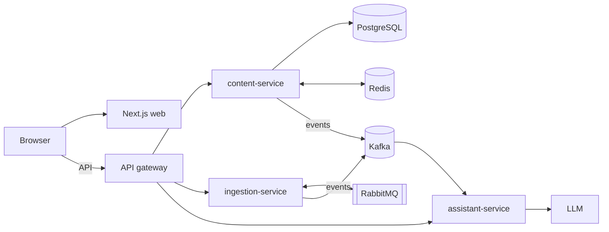

# The Dark Algorithm — Pulse

**Pulse** is a microservices blogging platform for **Tech · Football · AI**, with curated posts from
well-known writers and an AI assistant. It is built as a hands-on system-design project: every scaling
pattern is implemented, measured and documented with decision records.

> **Designed and developed by Ankur Kumar.** © 2026 **Ravenclaw_007 LLC**. All rights reserved.

## Architecture



| Layer | Technology |
|---|---|
| Services | Java 25, Spring Boot 4.1, Spring Security 7, Spring Data JPA, Flyway |
| Web | Next.js 16, React 19, Tailwind CSS 4, TypeScript |
| Data | PostgreSQL 18 + pgvector, Redis 8 |
| Messaging | Apache Kafka (KRaft), RabbitMQ |
| Platform | Docker Compose, Kubernetes (kind), Helm, HPA, KEDA |
| Quality | JUnit 5, Testcontainers, k6, Lighthouse |

## Progress

| Phase | Scope | Status |
|---|---|---|
| 0 | Foundations: repo layout, Docker Compose, ADRs | ✅ |
| 1 | content-service: Postgres, Flyway, keyset pagination, Problem Details | ✅ |
| 2 | Next.js website: ISR, tag revalidation, Lighthouse 100 | ✅ |
| 3 | Redis: cache-aside, single-flight, view counters, trending | ✅ |
| 4 | Admin: JWT + refresh rotation, CSRF, sanitized Markdown editor | ✅ |
| 5 | API gateway: routing, JWT validation, rate limiting | in progress |
| 6 | Kafka: transactional outbox, idempotent consumers | in progress |
| 7 | Ingestion with RabbitMQ: retries, DLQ, safe crawling | planned |
| 8 | AI assistant: RAG, tool calling, streaming | planned |
| 9 | Observability: metrics, logs, traces | planned |
| 10 | Kubernetes + Helm + autoscaling | in progress |
| 11 | CI/CD and deployment | planned |

## Run locally

Everything lives in [`Blog_007/`](Blog_007/README.md):

```bash
cd Blog_007
cp .env.example .env && ./scripts/gen-jwt-keys.sh && ./scripts/hash-password.sh
docker compose -f infra/docker-compose.yml --env-file .env --profile core up -d
./mvnw -pl services/content-service spring-boot:run -Dspring-boot.run.profiles=dev
cd web && npm install && npm run build && npm run start      # http://localhost:3000
```

Design decisions are recorded in [`Blog_007/docs/adr/`](Blog_007/docs/adr/).

---

**The Dark Algorithm** · Designed and developed by **Ankur Kumar** · Owned by **Ravenclaw_007 LLC**.
See [NOTICE](NOTICE).
